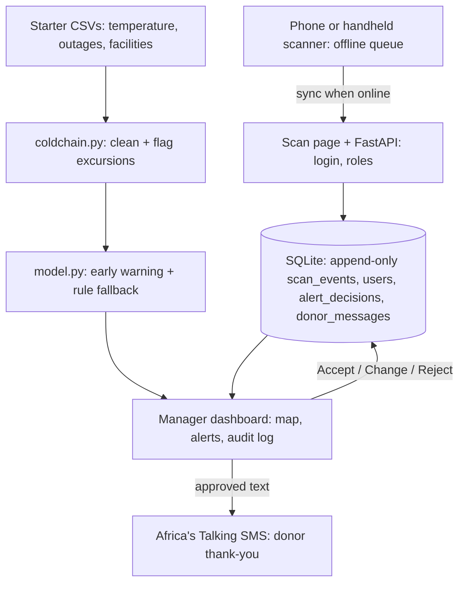

# Vein Map: know where every unit is, and catch a failing blood fridge before the blood is lost

Terumo BCT Africa Hackathon 2026 · Challenge area: **Cold chain** (within the vein-to-vein ABBIS framing)

## The problem

**User:** a regional blood centre manager, and the lab technician who hands units to hospitals.

**Today:** units move between centres, hospital fridges and cold boxes, tracked on paper registers and phone calls. Managers find out a fridge failed after the damage is done.

**What the starter data shows (47 facilities, 399,280 hourly fridge readings):**

- 14 of 47 facilities (30%) have **no backup power** on the blood fridge.
- 73% of all out-of-range hours (outside 2-6 °C) fall during or within 3 hours after a power outage.
- Sites with no backup account for **83%** of those outage-linked excursion hours.
- Where backup exists, 203 of 1,664 outages (12%) still left the fridge unprotected, so installing backup is not enough; it has to be maintained.
- The other 27% of excursion hours have no outage link (probably fridge faults or door-open events).
- Loggers go offline for long periods (one site is dark for about 13% of the year), so "no alert" does not mean "safe".

## What we built

**Works now**

- Offline-first **custody scan page**: camera scanner / typed ID. Scans queue on the phone and sync when the connection returns.
- **Append-only custody log** (collected, at_centre, in_transit, at_hospital, transfused, discarded). Out-of-order scans are flagged, never blocked. The tool records custody only; it never judges whether blood is safe or what to do with it.
- **Two roles** (technician, manager) with server-side enforcement. Every scan is stamped with the real user from the login token.
- **Manager dashboard:** facility map (fridge excursion rate, backup power, units held per facility), unit trail, audit log.
- **Fridge early-warning alerts** with reasons, a probability, and Accept / Change / Reject. Every decision is logged.
- **Donor thank-you SMS:** when a unit is scanned as transfused, a draft thank-you is queued for the donor, only if they consented to SMS. A manager approves, edits or rejects it, and approved messages go out through Africa's Talking. Every decision and send result is logged.

**Mocked or not finished**

- Alerts replay the **last 24 hours of the starter dataset**. Loggers are not feeding live data.
- The dataset has no donor phone numbers (only the last 4 digits). Test donors are team members who agreed to receive messages; their numbers are held outside the repository.
- The scan log and the temperature data are not linked per unit (by design: no safe-to-issue judgement).
- Reply-to-opt-out, a send delay, WhatsApp, SMS/USSD scanning, ISBT 128 parsing and FHIR/DHIS2 mapping are designed, not built.


| Role | Username | Password | Where |
|---|---|---|---|
| Technician | `tech1` | `tech-demo-1` | scan page `/` |
| Manager | `manager1` | `manager-demo-1` | scan page and `/dash/` |

Demo accounts, synthetic data only. The live demo may take about a minute to wake on first load, and its database resets on restart. Donor texts in the live demo go only to the team's test phones.

## How to run it

Needs Python 3.11+.

```bash
git clone [REPO URL] && cd [REPO]
python -m venv .venv && source .venv/bin/activate   # Windows: .venv\Scripts\activate
pip install -r requirements.txt
# the starter CSVs must be in data/ (facilities, temperature_logs, power_outages, units, donations, donors)
uvicorn api:app --port 8000          # terminal 1: scan page + API  -> http://localhost:8000
streamlit run app.py                  # terminal 2: dashboard        -> http://localhost:8501
python model.py                       # optional: reprints the baseline vs model numbers
```

Log in with the accounts above. Scan page: open `http://localhost:8000/?unit=<any unit_id from units.csv>`, record a scan, then check the dashboard's Audit tab. Camera scanning needs HTTPS or localhost.

**Donor thank-you SMS (optional).** Without keys, the app runs in dry-run mode: drafts and approvals work, and nothing is sent. To send real texts, create a `.env` file in the project root (it is git-ignored):

```
AT_USERNAME=your_africastalking_username
AT_API_KEY=your_api_key
```

and a git-ignored `data/demo_phones.csv` with columns `donor_id,phone` for donors who agreed to receive test messages. Then scan a unit belonging to one of those donors as **Transfused** and approve the draft in the dashboard's **Donor thank-yous** tab.

## Architecture




**Where it sits in a wider system:** this covers stages 03-05 of the vein-to-vein chain (lab release, inventory, hospital) at the custody and fridge-monitoring level, plus a light touch at the donor end through the thank-you message. The event log is the base layer; donor and patient records, requests and stock forecasting would attach to the same `unit_id`.

**Standards:** none implemented yet. ISBT 128 (bag barcodes to unit ID) and FHIR/DHIS2 mapping are designed, not built.

More detail: [docs/PROJECT.md](docs/PROJECT.md).

## AI and data

- **What it does:** predicts, for each fridge currently in range, whether it will leave 2-6 °C within the next 3 hours.
- **Model:** gradient boosting on current temperature, 1 h and 3 h change, outage status, hours since outage start, backup power, grid reliability.
- **Baselines:** (1) reactive threshold, which alerts only after the excursion, so lead time is 0 h; (2) rule: outage in progress and no backup power.
- **Result:** trained Nov 2025 to Jun 2026, tested Jul to Oct 2026 (133,095 hourly rows, 1,864 excursions starting within 3 h):

| Method | Precision | Recall | Alerts |
|---|---|---|---|
| Reactive threshold | n/a | 0.00 (lead time 0 h) | fires after the event |
| Rule: outage + no backup | 0.153 | 0.075 | 916 |
| **Model, alert at p ≥ 0.2** | **0.489** | **0.156** | **593** |

The model beats the rule at every threshold we tried (0.05 to 0.3). Rows are per hour, so one excursion can be flagged by several alerts.

- **How the reason is shown:** each alert lists plain-language factors from the model's inputs (outage in progress, no backup, rapid temperature rise) and a probability labelled as an estimate. These reasons are derived from rules over the features, not a formal model explanation.
- **Who approves:** a manager gives Accept, Change (note required) or Reject on every alert. Nothing is sent to a patient or moved without a person.
- **If the AI is wrong or off:** a toggle switches to the rule baseline; the threshold is adjustable; custody scanning does not depend on the model at all.
- **Donor messages are not AI-written.** They come from a fixed template, so there is nothing to invent. A person approves every one.

## Data

Starter dataset only: `facilities`, `temperature_logs`, `power_outages` for the fridge analysis, and `units`, `donations`, `donors` to find the donor behind a transfused unit. Glitch readings (-99.0, 99.9, 0.0) are excluded before counting excursions, and missing hours are reported as logger-offline time. No real donor, patient or facility data. Test phone numbers belong to team members who agreed, and are kept in a git-ignored file or in the host's secret settings.

## Donor thank-you and data protection

Goal: let donors know their blood helped someone, to counter donor apathy.

- **Consent first:** a draft is created only for donors with `consent_to_contact` and SMS as their preferred channel.
- **Minimal message:** "Thank you. Your blood donation of [date] has been used to help a patient. To stop these messages, tell your blood centre." It never names the patient, hospital, diagnosis or blood group.
- **Person in control:** a manager approves, edits or rejects each message. Nothing sends automatically.
- **Audit:** who approved, when, and the delivery result are logged. Phone numbers are never written to the database or the log.
- **Secrets and numbers stay out of the repo:** keys live in `.env` or the host's environment settings.
- **Not built:** reply-to-opt-out (so the message does not promise it), a 24-72 hour send delay, and skipping sends where a small facility could make a patient identifiable.
- This design follows data minimisation and consent principles (Kenya's Data Protection Act 2019 treats health data as sensitive). It has not had a legal review.

## African conditions

- **Connectivity:** the scan page is a few KB with no framework. Scans are saved on the phone, carry the device time and a unique event ID (safe to retry), and sync later. A service worker lets the page load with no connection. First login needs a connection; the token then lasts 7 days.
- **Power:** the analysis targets the outage-without-backup failure that dominates the data.
- **Equipment:** works with existing handheld barcode scanners (they type the ID and press Enter) and basic Android phones. Donors are reached by plain SMS, which works on any phone with no data.
- **Another site or country:** facilities and thresholds are data. Country settings for language, statuses and branding are planned, not built.
- **Not built:** SMS/USSD scanning for sites with no data connection, WhatsApp as a second donor channel, and local-language labels.

## AI tools we used

| Tool | What for |
|---|---|
| Claude (Anthropic) | Planning the build step by step; drafting and debugging code (data pipeline, model, API, scan page, dashboard, SMS integration, deployment config); drafting this README, the slides and the demo script. |

We ran, tested and can explain all of the code. [Add any other tools.]

## Team

| Name | Role | Country | Presenting Friday (in person / online) |
|---|---|---|---|
| Priscila Adhiambo Opiyo | Team lead, GIS and data | Kenya | [ ] |
| [name] | [role] | [country] | [ ] |

## Known limits and next steps

- Recall is low (about 16% at the default threshold). Many excursions have no outage signal, and temperature data is hourly, so fast failures are hard to predict.
- Alerts replay recorded data; live logger ingestion is next.
- Login has no rate limiting; tokens expire after 7 days, and queued scans from an expired login are rejected.
- The demo database is ephemeral (resets on restart).
- Donor texts: no reply-to-opt-out, no send delay, test numbers only.
- Next: ISBT 128 parsing, label printing from the processing centre, SMS/USSD scanning, WhatsApp, FHIR/DHIS2 mapping, per-episode lead-time metric, live loggers.
